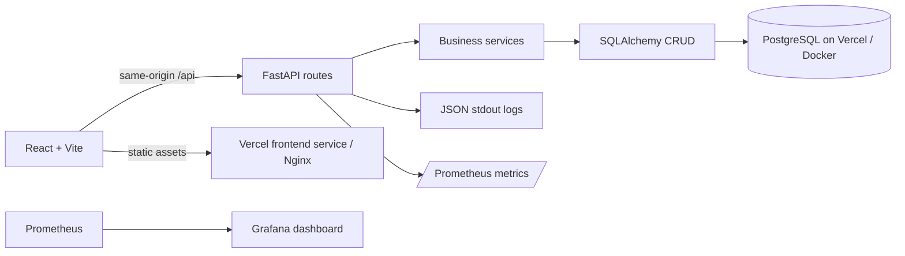

# Architecture and release notes

## Request flow

The API layer validates transport input and sets HTTP responses. Services enforce account, permission, voting, and result rules. CRUD owns SQL queries and persistence. Models and Pydantic schemas define storage and API contracts. The browser calls the API through the same origin in production; Vite proxies `/api` to FastAPI in development.

## Local release check

1. Install Node and Python dependencies as described in `README.md`.
2. Run `npm test` and `npm run build` before release. GitHub Actions runs the backend integration suite, legacy Node regression suite, and Vite production build on pushes and pull requests.
3. Run `python backend/scripts/seed_demo.py` against a local database to create a demo account and a poll with three venue options. The script refuses to run on Vercel or when `APP_ENV=production`.
4. Use `docker compose --env-file .env.docker up --build` for a container release rehearsal. Prometheus and Grafana are local operator tools and bind to loopback only.

## Production release and rollback

Vercel creates a production deployment for commits pushed to `main`. Check the deployment status and `/api/health` before announcing a release. If the release fails, use Vercel's deployment rollback to point the production alias to the last Ready deployment, then inspect request logs using `X-Request-ID` and the JSON log fields. The GitHub commit remains the source of truth for a follow-up fix.

Database schema changes must remain additive and safe to run repeatedly because the FastAPI lifespan applies the idempotent schema setup when a serverless instance starts. Back up PostgreSQL before a schema change. Keep the previous app version compatible with the expanded schema during rollback; destructive column removal requires a later cleanup release after all app instances have moved forward. Never roll back by deleting the database or its volume.

## Configuration and external services

- `DATABASE_URL_POOLED` is preferred for serverless SQLAlchemy connections; `DATABASE_URL` is the local/Docker fallback.
- `GOOGLE_CLIENT_ID` validates Google Identity Services ID tokens on the backend. `VITE_GOOGLE_CLIENT_ID` is the public client ID compiled into the frontend. OAuth secrets are not shipped to the browser.
- `COOKIE_SECURE=true` is required behind HTTPS; Vercel defaults it to true.
- Prisma Postgres currently uses the Free plan. It has a quota (100,000 monthly operations and 2 GB storage); watch provider usage before a public launch and upgrade only after reviewing price and traffic.
- The Google OAuth consent screen is currently in Testing mode. Only test users configured in Google Cloud can use it until the app is published and any Google verification requirements are met.

## Diagnostics

- `GET /api/health` checks database connectivity and returns 503 when PostgreSQL is unavailable.
- `GET /api/health/live` is a process liveness check.
- `GET /api/metrics` exposes Prometheus request totals and latency histograms.
- Each API request emits one JSON log line with request ID, method, path, status, and duration. The request ID is also returned in `X-Request-ID`.
- In Docker Compose, Prometheus is at `http://127.0.0.1:9090` and Grafana at `http://127.0.0.1:3001`. These endpoints are not published on the public interface by the compose configuration.
